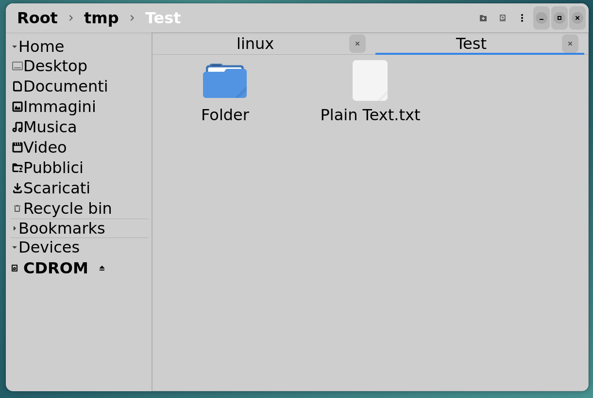

# Horizon
File manager for Linux with the most common features.

May have some unknown issues.

Requirements:
- python3
- Gtk4
- Udisks
- GnomeDesktop (for thumbnailers)

Features:
- recycle bin
- manages mass storage devices
- shortcuts
- custom scripts
- drag and drop support
- can be used in portable mode or can be installed (after creating a proper package o by using other installation methods): the installation directories are /usr/share for main folder HorizonFM4, and /usr/bin for the script needed to execute the main program
- very small, uses only the most common python stuff
- has a graphical setting application for all the supported options
- modern visual thanks to the Gtk4 toolkit.

